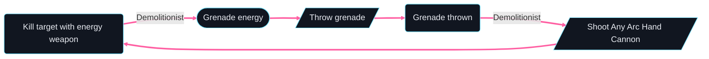

# Demolitionist Hunter — loop graph

Generated by `loopsmith graph builds/demolitionist-hunter/build.yaml --loops-only --limit 10` and `loopsmith loops builds/demolitionist-hunter/build.yaml --limit 10`.
How to read it — thick edges, labels: the [Skip Grenade Hunter's loop graph](../skip-grenade-hunter/loop-graph.md).

One loop, both halves of Demolitionist: throwing the grenade reloads the hand cannon (the edge from "Grenade
thrown" to "Shoot Any Arc Hand Cannon": its magazine is refilled, [ADRs D37](../../docs/ADRs.md#d37--a-reload-is-a-step-the-player-declares-and-a-rule-can-reload-a-weapon-no-ammo-is-counted)), and each of its kills
gives grenade energy back. The amount, 10%, is the hand cannon's (its archetype); the loop designed on it is
[loops/grenade-reload-kill.loop.yaml](loops/grenade-reload-kill.loop.yaml).



```text
1 loop found
Loop 1 · ability loop — gives grenade energy back · 5 steps
  Throw grenade → Grenade thrown →[Demolitionist] Shoot Any Arc Hand Cannon → Kill target with energy weapon →[Demolitionist] Grenade energy → ↺
```
