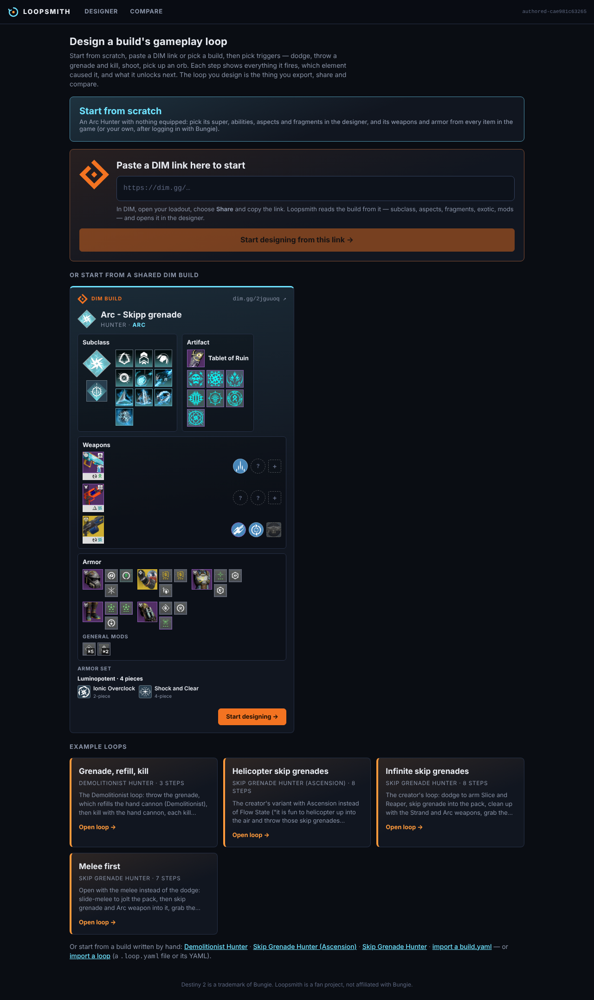
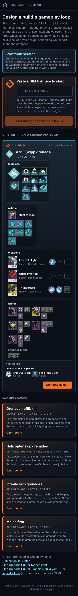

# Example loops

Until October 2026 Loopsmith shipped example builds and loops, and Home started a loop from a DIM link. Both were
removed: this page keeps what they were, how they were tested, and how example loops could come back. Everything here
is in the repository at commit `d56905d` (`git show d56905d:builds/…`, `git checkout d56905d -- builds`).

## What Home had





From the top: "Start from scratch", the "Paste a DIM link here to start" field, "Or start from a shared DIM build" (the
owner's own Arc Hunter, *Arc - Skipp grenade*, read from its saved dim.gg share), "Example loops" (four cards), and
"Or start from a build written by hand" (the three bundled builds) with "import a build.yaml" and "import a loop". The
Compare screen offered the example loops on each side too.

`builds/<slug>/` held each build: `build.yaml`, `discrepancies.md` (where the sources disagreed and what was encoded),
`loops/*.loop.yaml` (its designed loops), and for the Skip Grenade Hunter the owner's own build note (`note.txt`), its
golden-test mapping (`note-map.md`), the step sequence the trace test played (`scenario.txt`) and the saved DIM share
(`dim-loadout.json`).

| Build | Loop | What it showed |
|---|---|---|
| Skip Grenade Hunter (Plunderthabooty's video, the owner's note) | *Infinite skip grenades*, 8 steps | The creator's loop: dodge to arm Slice and Reaper, skip grenade into the pack, clean up with the Strand and Arc weapons, grab the orbs, skip grenade again. It repeats; Tempest Strike's Bolt Charge is listed as wasted (it doesn't stack with Dielectric's). |
| Skip Grenade Hunter | *Melee first*, 7 steps | The same build opening with the slide melee instead of the dodge; Gambler's Dodge's melee refill is unknown (`"?"`). |
| Skip Grenade Hunter (Ascension), one aspect swapped | *Helicopter skip grenades*, 8 steps | The creator's variant: Ascension's air move jolts the pack and makes you Amplified before the grenade lands. |
| Demolitionist Hunter (Mactics) | *Grenade, refill, kill*, 3 steps | The grenade refills an Arc hand cannon rolling Demolitionist, whose kills give grenade energy back. |

## Why they were removed

- **The rule scenarios cover the interactions now.** Every claim of a rule is an atomic e2e scenario
  (`tests/Loopsmith.Web.E2E/Rules/`), recorded on its pull request and playable from the VS Code extension. A whole
  build played end to end was the first way to see the engine work; it is no longer the best one.
- **Every rules PR conflicted on them.** Each example loop pinned the catalog version it was designed against
  (`catalog: authored-<12 hex>`), a hash of every file under `rules/`; any rules change moved it, so two open rules PRs
  always conflicted on those four lines.
- **The DIM link and the saved share** need every rule of the game to be useful: a real loadout names many elements
  Loopsmith doesn't have rules for yet. The Bungie login (the player's own items and stats) stays.

## How the tests looked

**A build note, line by line** (`SkipGrenadeHunterGoldenTests`, 20 tests). `note-map.md` turned each line of the
owner's note into an engine event, a start state and the elements that must (and must not) fire:

```csharp
// ── note line 1: Class ability ──
[Fact]
public void Line1_class_ability() =>
    AssertFires(Resolve(Fresh, new PlayerAction.UseClassAbility()),
        must: ["gamblers-dodge", "slice", "reaper", "bomber"]);
```

**A scenario played as one trace** (`Scenario_trace`): `scenario.txt` held one engagement as loop tokens (`class`,
`grenade:kill`, `kinetic:kill`, `pickup:orb-of-power`, `melee:slide:kill`, `max:bolt-charge`, `grenade:kill:last`,
`energy:kill`), and the whole trace was a Verify snapshot:

```text
#1 Class ability
  Class ability → Reaper (10s) [Reaper] + +1 Slice (8s) [Slice] + +?% melee energy [Gambler's Dodge] + +12% grenade energy [Bomber]
  Buffs         Reaper
  Weapons       Slice
#2 Grenade (💀 kill)
  Grenade 🥊 hit → Jolt target (10s) [Spark of Shock] + +1 Bolt Charge and +4.2% grenade energy [Shinobu's Vow]
  Grenade 💀 kill on Jolted target → Amplified (15s) [Flow State] + +1 Bolt Charge [Dielectric] + Ionic Trace [Shock and Clear] + doesn't stack with Dielectric [Tempest Strike]
```

**Each example loop** (`ExampleLoopsGoldenTests`, 15 tests): it imports and exports back byte for byte, has a
description and a note on every step, repeats (each pass ends with what the next one needs), and its loop report and
the comparison of two loops are snapshots:

```text
Infinite skip grenades — Skip Grenade Hunter · 8 steps
New pack → Class ability → Grenade (💀 kill) → Festival Flight (💀 kill) → Crisis Inverted (💀 kill) → Pick up Orb of Power → Bolt Charge at max (x10) → Grenade (💀 kill · ⬜ spend fully)
✓ Repeats — each pass ends with what the next one needs

#4 Festival Flight (💀 kill)
   needs            Slice ← #2 [Slice] · Unraveling Rounds ← previous pass #6 [Unraveling Orbs] · Jolt ← #3 [Spark of Shock] · Reaper ← #2 [Reaper]
   wasted           Tempest Strike — doesn't stack with Dielectric
```

The Core tests that only borrowed a bundled build or the DIM share as a starting point now start from scratch
(an Arc Hunter with nothing equipped, or a minimal build written in the test).

## How example loops could come back

What an example needs:

- **Only elements with rule scenarios.** Every step's outcome is already a recorded claim, so the example plays no
  rule nobody checked.
- **No personal data.** No one's DIM share or membership; a creator's build is named and linked, never transcribed
  (transcripts are third-party content).
- **No `catalog:` line**, so a rules PR never touches it (a loop without one replays against whatever catalog opens it).
- **A golden test of what makes it an example:** that it repeats, and what it wastes.

Shapes it could take:

1. **One short loop per subclass**, built from its rule scenarios: three to five steps, each step's note naming the rule
   scenario that shows it, with a "▶ recording" link to that scenario's GIF.
2. **A "how it chains" card under each rule scenario**: the rule viewer's flow (trigger ➜ what must be in place ➜ what
   it gives) followed into the next rule, as a loop the player can open.
3. **Creator builds again**, once the rules cover them: the `build-extractor` subagent below turns a creator's video or a
   note into a build, its note map and its discrepancies; the golden tests above are its shape.

## The build-extractor subagent

`.claude/agents/build-extractor.md`, verbatim as it was at `d56905d`. To use it again, copy it back there (its paths
point to `builds/`).

````markdown
---
name: build-extractor
description: Turns a Destiny 2 build video transcript/description or a user's build note into builds/<slug>/build.yaml (per docs/rule-format.md), builds/<slug>/note-map.md (the golden-test mapping - every note line as an engine event, a scenario and the elements that must fire, plus the missing elements to author) and the source disagreements in builds/<slug>/discrepancies.md. Use when a new build is added or a build note changes.
tools: Read, Grep, Glob, Edit, Write, Bash
---

You turn a build someone describes into the files Loopsmith needs to replay it. Loopsmith describes cause
and effect in a build and doesn't simulate the game (ADRs D1): what you map is what each trigger sets off.
Your inputs are usually `builds/<slug>/transcript.txt` (a creator's video: third-party content, kept
local and gitignored — never
commit it, link the video instead), a description or URL, and/or `builds/<slug>/note.txt` (the user's own
notes on the loop). You write three files and nothing else: `build.yaml`, `note-map.md` and
`discrepancies.md`, all in `builds/<slug>/`. See `builds/skip-grenade-hunter/` for a complete example.
A **derived build** (a creator's stated variant of an existing build, e.g. one aspect swapped) has no note of
its own: write only `build.yaml` (its header names the parent and quotes the source of the variant) and a
short `discrepancies.md` for what differs, pointing to the parent's — see `builds/skip-grenade-hunter-ascension/`.

## Before you write anything

1. Read the **Build file** and **Engine semantics** sections of `docs/rule-format.md`, the action tokens
   of `docs/loop-format.md`, and ADRs D1 and D3–D9 in `docs/ADRs.md` (the engine model, summarised below).
2. Build an index of the elements that already exist: grep `rules/**/*.yaml` for `id:` and `name:`
   (abilities, aspects, fragments, exotics, armor-set bonuses, mods, artifact perks, weapon perks, keywords)
   and read `rules/glossary.yaml`. Reuse existing ids exactly. Match by name, and treat the user's typos
   ("gamblers doge", "greaned") as the real names.

## Engine model (what a claim can turn into)

- **"The pack in front of you" (D7).** One abstract target with a tier; a debuff stays on the pack, kill
  after kill, until the player declares it ended (`end:jolt`) or a new pack (`pack:new`, "the next
  group").
- **Numbers are facts; the player declares thresholds (D1, D3).** "+1 Bolt Charge", "for 10 s", "up to
  x10" are facts on the outcome. "At 10 stacks" becomes a step where the
  player declares the state (`max:bolt-charge`, "Bolt Charge at max"), and a buff that has ended becomes
  `end:<status>` ("Amplified ends"). A counter the game doesn't show as a stacking status ("after 3 kills", "every 2nd trace") is a
  *(chance)* rule (D8). A claim about a count, a duration or a threshold is reproduced as a declaration, a
  *(chance)* rule or a fact — never "not reproduced".
- **Energy outcomes are facts (D5).** Abilities are always available. "Refills melee" and other energy
  claims are reproduced as outcomes the trace shows. A step is blocked only when it can't happen at all (nothing of
  that pickup on the ground, no weapon in that slot, a declaration that doesn't hold).
- **Target counts (D4).** The player says how many enemies an action hits (`grenade:kill:3`). A claim that
  depends on several targets in one action maps to an action with a count and an `atLeast` trigger.
- **Rules that don't stack (D6).** When the game says two elements' grants don't stack, one rule gives way
  (`doesNotStackWith`): it still counts as fired, gives nothing, and a loop's analysis lists it as wasted
  at that step.

## 1. `builds/<slug>/build.yaml`

- Follow the build file shape exactly: `name`, `author`, `source` (video URL), `class`, `subclass`,
  `super`, `grenade`, `melee`, `classAbility`, `aspects`, `fragments`, `exoticArmor`, `armorSetBonuses`,
  `armorMods`, `artifactPerks`, `weapons` (`{ slot, name, type, archetype, perks }`), `stats` (`weapons`,
  `health`, `class`, `grenade`, `super`, `melee`; 0..200). Leave out `catalog` (an optional pin).
- Repeat a mod once per copy equipped (`[grenade-kickstart, grenade-kickstart]`). Stacking changes the
  `PerModCount` value used.
- Include only what the sources state. Leave out optional fields that are not mentioned, and include
  `stats` only for values that are shown or said. When a required slot is not stated but is strongly
  implied, use it and add a comment saying it is unconfirmed or inferred, and why. List it under
  *Open questions* in the note map.
- Use existing ids. For elements that do not exist yet, use the kebab-case slug of the in-game name
  (`impact-induction`, `luminopotent-4pc`) and mark them missing in the note map.

## 2. `builds/<slug>/note-map.md`: the golden-test mapping

The note map is the contract between the user's note and the engine: the golden tests
(`tests/Loopsmith.Core.Tests/Golden/`) implement one test per scenario in it. Follow
`builds/skip-grenade-hunter/note-map.md`:

- **Intro and conventions**: which build and rules the scenarios assume; what **fired**, **gives way**
  (`doesNotStackWith`), *(chance)*, **passive** and "Fresh" (no buffs, a pack with no debuffs, nothing on
  the ground) mean; that state is what is present (buffs by name, "(at max)" when declared, the pack's
  debuffs, pickups on the ground); that keyword elements are active in every build.
- **Summary table**: `| # | Note line (trigger) | Engine event | Must fire | Not reproduced |`, one row per
  line of `note.txt` (a title line has no trigger).
- **One section per note line**, headed with the line verbatim:
  - **Event**: the engine event in Domain terms (`AbilityCast(ClassAbility)`, `Killed(…)` where target has
    [jolt], `PickedUp(ionic-trace)`, `StacksMaxed(bolt-charge)` from a `max:bolt-charge` step).
  - **Scenario(s)**: a start state (buffs, target debuffs, pickups on the ground: present or not, and "at
    max" for a declared buff) and one step: a player action (`UseClassAbility`, `FireWeapon(Kinetic, kill)`
    — the token is `kinetic:kill`) or a declared state (`max:bolt-charge`, `end:amplified`).
  - What fires at each cascade depth, element id → outcome, then the **Fired** set, the **End state**
    (present / at max (declared) / not present) and **Must NOT fire** where that matters.
  - **Fully reproduced**, or **Reproduced differently** / **Not reproduced** with the reason, pointing at
    the `discrepancies.md` row.
- Break a compound claim ("X -> A + B + C") into one expectation per element. Use the format's vocabulary
  (`kill via weapon:strand`, `spawn orb-of-power`, `applyBuff amplified`).
- Check expectations against the engine where you can: `dotnet test --filter RepoFileValidationTests` checks
  that the build opens against the rules, and the steps that lead to a start state, then the scenario's step,
  can be played in the web designer (`dotnet run --project src/Loopsmith.Web`) or in a scratch Core test the
  way `tests/Loopsmith.Core.Tests/Golden/SkipGrenadeHunterGoldenTests.cs` plays them (report, don't commit it).
- End with **Missing elements to author** (grouped by target rules file; for each: id, name, kind, the
  claims it must satisfy and the source quotes — the `rule-author` agent works from this list) and
  **Open questions** (unconfirmed slots, claims the rule format cannot express). Leave out a section that
  would be empty.

## 3. `builds/<slug>/discrepancies.md`

Every disagreement between the sources gets one row (CLAUDE.md, "Source priority"). Follow the existing
file: the sources in priority order (game data — Compendium snapshot / Clarity — > the user's note > the
creator's video), then `| # | Topic | Note says | Video says | Game data says | Encoded | Why |`. Fill the
note and video columns with short quotes; leave **Game data says** and **Encoded** for the `rule-author`
when no game data is in hand (write "—", never a guess). Numbers or interactions only the creator states
are creator claims: quote them with a timestamp or position. They never override the user's note or game
data.

## Boundaries

Write only those three files. Do not author rules, do not edit `rules/`, `src/` or tests, and never invent
numbers or loadout pieces. Never commit `transcript.txt`. Designed loops (`builds/<slug>/loops/*.loop.yaml`)
are made by the user with the web designer's Export — not yours to write unless
asked. Finish with a short summary: the note lines mapped (fully reproduced / differently / not
reproduced), the missing elements, the discrepancy rows and the open questions.
````
